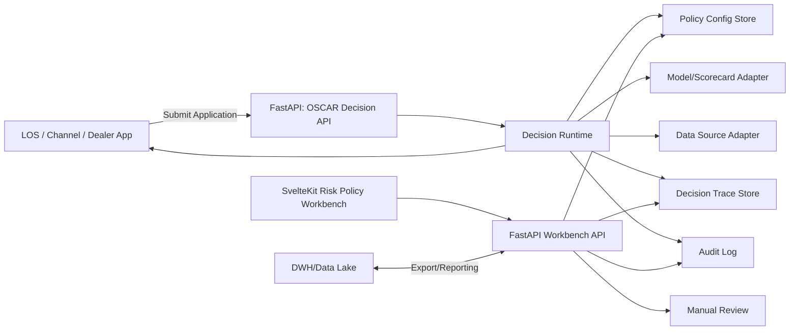
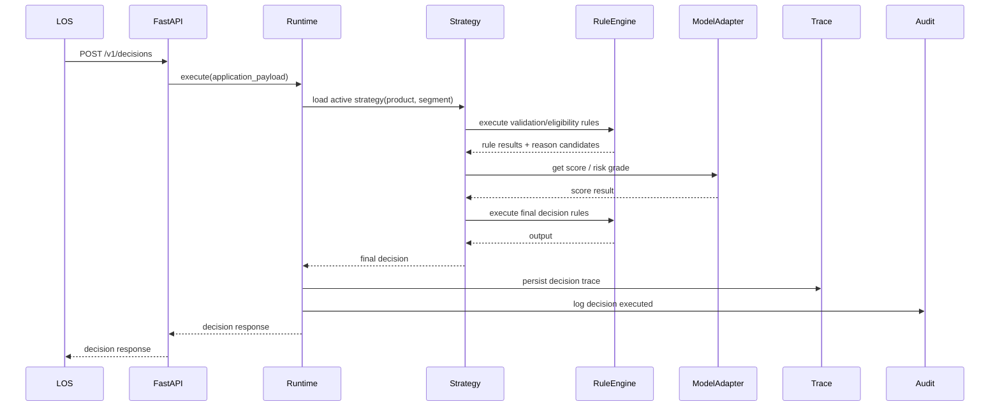
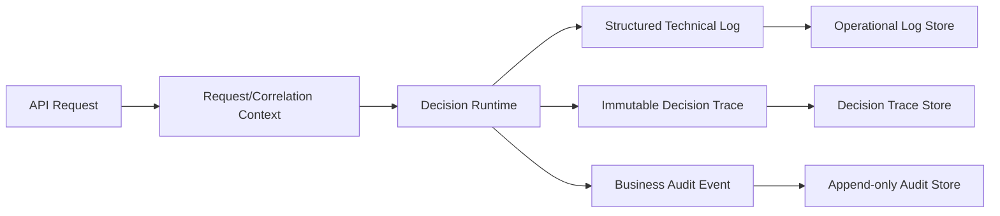

# 03 — Architecture

## 1. Architecture Principles

1. **Configurable decisioning:** credit policy tidak di-hardcode.
2. **Versioned execution:** setiap decision menunjuk strategy/rule/model version.
3. **Trace-first:** setiap decision harus explainable.
4. **MVP simplicity:** gunakan step-based strategy builder dulu, bukan visual canvas.
5. **Separation of concerns:** pisahkan core decision engine dari LOS/LMS/collection/KYC/AML.
6. **Integration-ready:** siapkan adapter untuk LOS, model service, bureau, eKYC, DWH.
7. **FastAPI backend:** semua runtime/workbench API disediakan melalui FastAPI.
8. **SvelteKit frontend:** Workbench UI dibangun dengan SvelteKit + TypeScript + Tailwind.
9. **Evidence separation:** technical logs, decision traces, dan business audit events memiliki storage/retention/access pattern yang berbeda.
10. **Correlation-first:** request/correlation ID dipropagasikan dari API ke runtime, adapters, trace, dan audit event.

## 2. Chosen Tech Stack

| Layer | Technology | Notes |
|---|---|---|
| Backend API | FastAPI `0.139.0` | Runtime Decision API + Workbench API; install `fastapi[standard]==0.139.0` |
| Backend language | Python `>=3.12,<3.15` | Pin exact version per environment |
| Validation | Pydantic v2 | API schemas and domain validation |
| DB | PostgreSQL | Main transactional store |
| ORM/migration | SQLAlchemy 2.x + Alembic | Schema migration and DB access |
| Test | pytest + httpx | Unit and API tests |
| Frontend | SvelteKit latest stable at scaffold time | Internal enterprise workbench; lock version |
| Frontend language | TypeScript | Safer API DTOs and UI state |
| CSS | Tailwind CSS latest stable at scaffold time | Dense internal UI, forms, tables, panels; lock version |
| API docs | OpenAPI | Generated by FastAPI |


## 2.1 Version Pinning Decision

Backend FastAPI must be pinned explicitly:

```text
fastapi[standard]==0.139.0
```

Frontend SvelteKit/Tailwind packages may be initialized with the latest stable scaffolding command, but the resulting package manager lockfile must be committed. Do not leave frontend dependency versions floating in production.

## 3. High-Level System Context



## 4. Recommended Deployment Boundary

MVP should start as a **modular monolith**, not microservices.

Why:

- faster implementation,
- easier transaction management,
- easier local development,
- fewer deployment moving parts,
- still modular enough to split later.

## 5. Recommended Repository Structure

```text
oscar-decision-engine/
├── backend/
│   ├── app/
│   │   ├── api/
│   │   │   └── v1/
│   │   ├── modules/
│   │   │   ├── auth/
│   │   │   ├── decisions/
│   │   │   ├── rules/
│   │   │   ├── strategies/
│   │   │   ├── scorecards/
│   │   │   ├── simulations/
│   │   │   ├── manual_review/
│   │   │   ├── audit/
│   │   │   └── monitoring/
│   │   ├── shared/
│   │   │   ├── config/
│   │   │   ├── database/
│   │   │   ├── domain/
│   │   │   └── utils/
│   │   └── main.py
│   ├── tests/
│   ├── alembic/
│   └── pyproject.toml
├── frontend/
│   ├── src/
│   │   ├── lib/
│   │   │   ├── api/
│   │   │   ├── components/
│   │   │   ├── stores/
│   │   │   └── types/
│   │   ├── routes/
│   │   │   ├── dashboard/
│   │   │   ├── decisions/
│   │   │   ├── rules/
│   │   │   ├── strategies/
│   │   │   ├── simulations/
│   │   │   ├── manual-review/
│   │   │   ├── audit/
│   │   │   └── admin/
│   │   └── app.css
│   └── package.json
├── docs/
└── AGENTS.md
```

## 6. Main Backend Modules

| Module | Responsibility |
|---|---|
| Auth/RBAC | Authentication, authorization, role and permission checks |
| Decisions | Runtime decision API, decision result, decision history |
| Rules | Rule definitions, versions, condition trees, action mappings |
| Strategies | Strategy definitions, ordered execution steps, active version |
| Scorecards | Scorecard/model references and result mapping |
| Simulations | Single and batch non-production runs |
| Manual Review | Manual review queue, case detail, analyst decision |
| Audit | Audit event logging and change reconstruction |
| Monitoring | Aggregated decision metrics |

## 7. Main Frontend Screens

| Route | Screen |
|---|---|
| `/dashboard` | Basic decision dashboard |
| `/decisions` | Decision history |
| `/decisions/[id]` | Decision trace/detail |
| `/rules` | Rule list |
| `/rules/[id]` | Rule editor/detail |
| `/strategies` | Strategy list |
| `/strategies/[id]` | Step-based strategy editor |
| `/simulations` | Simulation workspace |
| `/manual-review` | Manual review queue |
| `/manual-review/[id]` | Case detail |
| `/audit` | Audit log |
| `/admin` | RBAC/admin |

## 8. Decision Execution Sequence



## 9. Strategy Execution Model

MVP uses ordered steps:

```json
{
  "strategy_code": "LEASEBACK_MOTOR_V1",
  "version": 1,
  "steps": [
    {"order": 1, "type": "VALIDATION", "ref": "REQUIRED_FIELDS"},
    {"order": 2, "type": "RULE_SET", "ref": "ELIGIBILITY_MOTOR"},
    {"order": 3, "type": "RULE_SET", "ref": "FRAUD_BASIC"},
    {"order": 4, "type": "CALCULATION", "ref": "AFFORDABILITY"},
    {"order": 5, "type": "SCORECARD", "ref": "MOTOR_SCORECARD"},
    {"order": 6, "type": "DECISION_TABLE", "ref": "FINAL_DECISION_MATRIX"}
  ]
}
```

## 10. Rule Evaluation Model

MVP rule format is condition tree + action. Avoid raw SQL by default.

```json
{
  "rule_code": "LTV_MAX_MOTOR",
  "condition": {
    "all": [
      {"field": "loan.ltv", "operator": ">", "value": 0.85},
      {"field": "vehicle.type", "operator": "=", "value": "MOTOR"}
    ]
  },
  "action": {
    "decision": "MANUAL_REVIEW",
    "reason_code": "LTV_ABOVE_THRESHOLD"
  }
}
```

## 11. Data Integration Design

| Adapter | MVP Mode | Future Mode |
|---|---|---|
| LOS Adapter | Receive payload | Bidirectional status update |
| Bureau/SLIK-like Adapter | Mock payload field | External API integration |
| eKYC/Dukcapil Adapter | Mock verification field | External API integration |
| Model Serving Adapter | Accept score from payload | Call ML service |
| DWH Export | CSV/manual export | Event streaming/ETL |
| LMS/Core Adapter | Not in MVP | Customer exposure/active loans |

## 12. Security Architecture

- Use authenticated API access.
- Use RBAC for Workbench.
- Store PII carefully; mask in UI based on permission.
- Log access to sensitive decision details.
- Use idempotency key for decision submission.
- Separate production decisions from simulations.

## 13. Key Non-Functional Requirements

| Area | Requirement |
|---|---|
| Explainability | Every decision has trace |
| Auditability | Every config change has audit log |
| Latency | Define P95 target; MVP e.g. < 500ms without external calls |
| Availability | Runtime API prioritized over Workbench UI |
| Determinism | Same input + same strategy version should produce same output |
| Versioning | Rule/strategy/model versions immutable once active |
| Data Protection | PII masking and permission-based access |

## 14. Observability and Audit Architecture



Rules:

- Technical logs are optimized for troubleshooting and operational retention.
- Decision traces are immutable and optimized for decision reconstruction.
- Business audit events are append-only and optimized for compliance/governance queries.
- Correlation ID links the layers without copying raw sensitive payloads.
- Audit persistence failure for critical state changes must be explicit; it cannot silently succeed.
- Metrics must avoid PII/high-cardinality customer identifiers.

See `docs/18_observability_and_audit_logging.md`.

## 15. Delivery and Repository Discipline

- Use isolated branch/worktree and local commits per coherent phase.
- Update docs, tests, migrations, and contracts in the same commit as behavior changes.
- Maintain implementation status and ADR-style decisions.
- Never push or deploy autonomously.

See `docs/17_git_workflow_and_progress_logging.md`.
