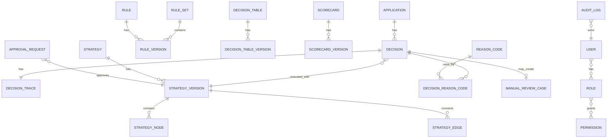

# 06 — Data Model

## 1. Conceptual ERD



## 2. Core Entities

### 2.1 `applications`

Stores inbound application metadata and normalized snapshot.

| Field | Type | Notes |
|---|---|---|
| id | UUID | Internal ID |
| application_id | string | External LOS/channel ID |
| product_type | enum | MOTOR_LEASEBACK, CAR_LEASEBACK, AUTO_LOAN, etc. |
| channel | string | branch, dealer, partner, app |
| applicant_id | string | Internal/customer reference; PII policy applies |
| status | enum | RECEIVED, DECIDED, PENDING_REVIEW, ERROR |
| payload_snapshot | jsonb | Input snapshot for reconstruction |
| created_at | timestamp |  |

### 2.2 `decisions`

Stores final decision result.

| Field | Type | Notes |
|---|---|---|
| id | UUID | Decision ID |
| application_id | FK |  |
| external_application_id | string | For quick lookup |
| decision | enum | APPROVE, REJECT, MANUAL_REVIEW, APPROVE_WITH_CONDITION |
| risk_grade | string | A/B/C/D/E |
| score | decimal | Optional |
| approved_limit | decimal | Optional |
| approved_tenor_months | int | Optional |
| pricing_rate | decimal | Optional |
| strategy_version_id | FK | Immutable reference |
| execution_mode | enum | PRODUCTION, SIMULATION |
| idempotency_key | string | Optional unique key |
| created_at | timestamp |  |

### 2.3 `decision_traces`

Stores full explainability trace.

| Field | Type | Notes |
|---|---|---|
| id | UUID |  |
| decision_id | FK |  |
| input_snapshot | jsonb | Exact input used |
| feature_values | jsonb | Normalized/calculated features |
| step_results | jsonb | Ordered execution trace |
| rule_results | jsonb | Pass/fail/triggered rules |
| score_results | jsonb | Score/model details |
| final_output | jsonb | Decision response |
| errors | jsonb | Optional |
| latency_ms | int | Runtime latency |
| request_id | string | Technical request identifier |
| correlation_id | string | Cross-service correlation identifier |
| created_at | timestamp |  |

### 2.4 `rules`

Rule logical identity.

| Field | Type | Notes |
|---|---|---|
| id | UUID |  |
| rule_code | string | Unique stable code |
| name | string | Human readable |
| category | enum | ELIGIBILITY, AFFORDABILITY, FRAUD, LIMIT, PRICING, ROUTING |
| owner_team | string | Risk/Fraud/etc |
| created_by | FK user |  |
| created_at | timestamp |  |

### 2.5 `rule_versions`

Immutable version of rule definition.

| Field | Type | Notes |
|---|---|---|
| id | UUID |  |
| rule_id | FK |  |
| version | int |  |
| status | enum | DRAFT, PENDING_APPROVAL, ACTIVE, RETIRED |
| condition_json | jsonb | DSL/condition tree |
| action_json | jsonb | Decision/action/reason outputs |
| effective_from | timestamp | Optional |
| effective_to | timestamp | Optional |
| created_by | FK user |  |
| approved_by | FK user | nullable |
| created_at | timestamp |  |

### 2.6 `strategies`

Strategy identity per product/segment.

| Field | Type | Notes |
|---|---|---|
| id | UUID |  |
| strategy_code | string | e.g. LEASEBACK_MOTOR |
| product_type | enum |  |
| segment | string | optional |
| name | string |  |
| owner_team | string |  |

### 2.7 `strategy_versions`

Immutable executable strategy.

| Field | Type | Notes |
|---|---|---|
| id | UUID |  |
| strategy_id | FK |  |
| version | int |  |
| status | enum | DRAFT, PENDING_APPROVAL, ACTIVE, RETIRED |
| effective_from | timestamp |  |
| effective_to | timestamp | optional |
| activated_at | timestamp | optional |
| activated_by | FK user | optional |

### 2.8 `strategy_nodes` and `strategy_edges`

Phase 3 replaces the linear `strategy_steps` table with a persisted DAG. Existing rows were data-migrated to equivalent START → step nodes → END graphs.

`strategy_nodes`:

| Field | Type | Notes |
|---|---|---|
| id | UUID | Internal node ID |
| strategy_version_id | FK | Owning immutable strategy version |
| node_key | string | Stable key unique within the version |
| node_type | enum/string | START, END, VALIDATION, CALCULATION, RULE_SET, SCORECARD, DECISION_TABLE, CONDITION |
| name | string | Human-readable label |
| reference_code | string | Optional rule-set, scorecard, or table code |
| on_error | enum | FAIL, MANUAL_REVIEW, CONTINUE |
| config_json | jsonb | Required fields, calculations, or CONDITION DSL |
| position_x / position_y | int | Canvas coordinates; execution does not depend on them |

`strategy_edges`:

| Field | Type | Notes |
|---|---|---|
| id | UUID | Internal edge ID |
| strategy_version_id | FK | Owning immutable strategy version |
| from_node_key | string | Source node |
| to_node_key | string | Destination node |
| label | string/null | `TRUE`/`FALSE` for CONDITION edges; null otherwise |

The graph validator enforces one START, at least one END, no cycles, no orphan nodes, valid branch labels, no self-loops or duplicate edges, and configured size limits. Legacy API requests using `steps[]` remain accepted and are converted server-side to a linear graph.

### 2.9 `reason_codes`

| Field | Type | Notes |
|---|---|---|
| id | UUID |  |
| code | string | e.g. HIGH_DTI |
| category | enum | AFFORDABILITY, FRAUD, BUREAU, ELIGIBILITY |
| internal_message | text |  |
| customer_message | text | optional |
| severity | enum | INFO, WARNING, DECLINE, REVIEW |
| active | bool |  |

### 2.10 `manual_review_cases`

| Field | Type | Notes |
|---|---|---|
| id | UUID |  |
| case_id | string | readable |
| application_id | FK |  |
| decision_id | FK | system decision |
| status | enum | NEW, ASSIGNED, IN_REVIEW, PENDING_DOCS, ESCALATED, CLOSED |
| priority | enum | LOW, MEDIUM, HIGH |
| assigned_to | FK user | nullable |
| system_decision | enum |  |
| analyst_decision | enum | nullable |
| override_reason | text | required for override |
| notes | text |  |
| created_at | timestamp |  |
| closed_at | timestamp | nullable |

### 2.11 `audit_logs`

| Field | Type | Notes |
|---|---|---|
| id | UUID |  |
| actor_user_id | FK user | nullable for system |
| actor_type | enum | USER, SYSTEM, API_CLIENT |
| event_type | string | RULE_CREATED, STRATEGY_ACTIVATED, DECISION_EXECUTED |
| entity_type | string |  |
| entity_id | string |  |
| before_value | jsonb | nullable |
| after_value | jsonb | nullable |
| action | string | Human/machine action name |
| entity_version | string/int | Exact affected version where applicable |
| reason | text | Required for approval, rejection, override, rollback |
| correlation_id | string | Cross-service correlation identifier |
| request_id | string | API request identifier where applicable |
| metadata | jsonb | Sanitized context such as approval request; no raw PII/secrets |
| created_at | timestamp |  |

## 3. Supporting Entities

| Entity | Purpose | MVP? |
|---|---|---:|
| `rule_sets` | Group rules for strategy steps | Yes |
| `decision_tables` | Identity for decision matrix | Yes |
| `decision_table_versions` | Immutable table version | Yes |
| `scorecards` | Scorecard/model identity | Yes/basic |
| `scorecard_versions` | Version and score band config | Yes/basic |
| `features` | Feature catalog/data dictionary | Phase 2, minimal in MVP |
| `data_sources` | External/internal source config | Phase 2 |
| `simulations` | Simulation job/session | Yes/basic |
| `simulation_results` | Simulation output | Yes/basic |
| `approval_requests` | Maker-checker workflow | Phase 2/basic optional |
| `users`, `roles`, `permissions` | RBAC | Yes |

## 4. Important Enums

### Decision

```text
APPROVE
REJECT
MANUAL_REVIEW
APPROVE_WITH_CONDITION
REQUEST_ADDITIONAL_DOCUMENT
FRAUD_INVESTIGATION
ERROR
```

### Product Type

```text
MOTOR_LEASEBACK
CAR_LEASEBACK
AUTO_LOAN_MOTOR
AUTO_LOAN_CAR
MULTIPURPOSE_LOAN
TOP_UP
```

### Rule Category

```text
VALIDATION
ELIGIBILITY
AFFORDABILITY
BUREAU
FRAUD
COLLATERAL
LIMIT
TENOR
PRICING
ROUTING
FINAL_DECISION
```

## 5. Example Decision Record

```json
{
  "decision_id": "DEC-20260704-0001",
  "application_id": "APP-20260704-0001",
  "decision": "APPROVE_WITH_CONDITION",
  "risk_grade": "B",
  "score": 684,
  "approved_limit": 12500000,
  "approved_tenor_months": 18,
  "pricing_rate": 0.025,
  "reason_codes": ["REQUESTED_AMOUNT_ABOVE_ELIGIBLE_LIMIT"],
  "strategy_version": "LEASEBACK_MOTOR_V3"
}
```

## 6. Logging and Evidence Storage Rules

- Do not store technical runtime logs in `audit_logs`.
- `decision_traces` store immutable decision-execution evidence.
- `audit_logs` store append-only business/governance events.
- Technical logs are emitted to an operational logging sink and contain only sanitized identifiers.
- Correlation ID links technical logs, trace, and audit events.
- Add indexes for `correlation_id`, `request_id`, event/entity fields, and decision/application lookup.
- Retention is configurable and must not be implemented by deleting immutable decision/audit evidence without an approved policy.

## 7. As-Built Addendum (Implementation v0.1, 2026-07-04)

Schema is defined by SQLAlchemy models (`backend/app/models.py`) and Alembic migration `45ac3e82696b`. Deltas from the conceptual tables above:

- Internal FKs use `application_pk` / `decision_pk` / `simulation_pk` (UUID) to distinguish them from external business identifiers (`application_id`, `decision_id` strings).
- `decisions.reason_codes_json` (jsonb) stores the ordered reason codes with the decision; `decision_reason_codes` join table was not needed for MVP.
- `decisions.idempotency_key` has a partial unique index (`WHERE idempotency_key IS NOT NULL`).
- `rule_versions.version_note`, `strategy_versions.version_note`, and `*_versions.created_by/approved_by` support governance display.
- `rule_set_members` implements the `rule_sets` grouping with `execution_order`.
- `manual_review_cases` adds `analyst_decided_by/at`, `override_reason_code`, `approved_limit`, `approved_tenor_months`.
- `audit_logs.actor_label` denormalizes the username for stable audit display; `metadata_json` holds sanitized context.
- Config statuses are `DRAFT / PENDING_APPROVAL / ACTIVE / REJECTED / RETIRED` (REJECTED added for maker-checker rejections).
- All jsonb columns use PostgreSQL `JSONB`; enums are stored as constrained varchar for migration simplicity.

## 8. Phase 2 Addendum (2026-07-05)

Tables added in Phase 2 (migrations `cc396755f845`, `553675a0147d`, `d915f8cefdbb`, `1864d7efc83f`):

- `features` — governed data dictionary (path, label, data_type, source, category, allowed_values, active).
- `manual_review_comments` — append-only case comment thread.
- `manual_review_documents` — requested-document checklist (status REQUESTED/RECEIVED/WAIVED).
- `registered_models` — model registry (code+version_label unique, provider, active, metadata).
- `manual_review_cases` gains `sla_due_at`, `escalated_to`.
- `approval_requests` gains `simulation_ref` (attached simulation evidence for maker-checker).

## 9. Phase 3 Addendum (2026-07-11)

Phase 3 is represented by Alembic migrations `8f3c2a1b7d04` (rule model/catalog additions) and `f4b7c9d2e601` (strategy graph conversion).

### Rule model and catalogs

- `rule_versions` now stores `rule_kind`, optional `branches_json`, nullable legacy `action_json`, and optional `expression_text`.
- A v2 rule uses exactly one authoring shape: legacy `condition + action`, ordered `branches + default_actions`, or admin-gated `expression + output_target`.
- `features` adds `writable`; `RULE_OUTPUT` identifies governed output targets.
- `rule_categories` is a managed, audited catalog used by rule validation and workbench metadata.

### Strategy graph storage

- Migration M2 creates `strategy_nodes` and `strategy_edges`, converts every historical `strategy_steps` version to a behavior-equivalent linear graph, then removes `strategy_steps`.
- The downgrade is intentionally linear-only: it reconstructs steps only when the graph is representable as a single path.
- Canvas positions are presentation metadata; deterministic edge traversal and node configuration define execution.

### Trace additions

- Each execution step records `node_key`; CONDITION entries also record `condition_result` and `taken_edge`.
- Strategy trace metadata records `execution: "GRAPH"`.
- A masked top-level `outputs` snapshot captures governed values produced by rules and tables without exposing denied PII keys.
