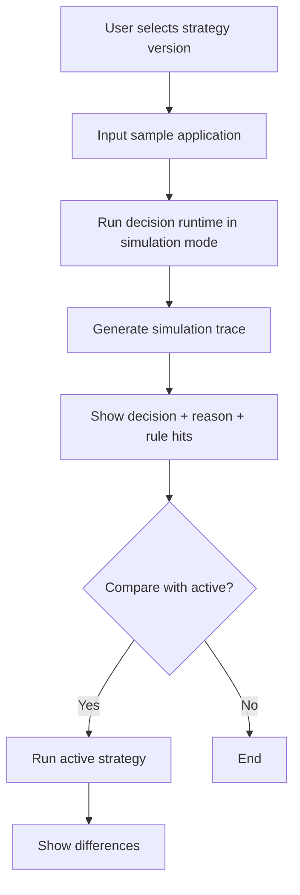

# 12 — Simulation Design

## 1. Purpose

Simulation lets risk team test policy changes before production. It prevents policy changes from going live blindly.

Common questions:

- Kalau DTI threshold turun dari 45% ke 40%, approval rate turun berapa?
- Rule mana yang paling banyak menyebabkan reject?
- Apakah policy baru terlalu ketat untuk dealer/channel tertentu?
- Apakah draft strategy mengubah banyak keputusan dibanding active strategy?

## 2. MVP Scope

MVP supports **single application simulation** and **active vs draft comparison**.

Batch/historical simulation is Phase 2.

## 3. Simulation Types

| Type | Phase | Description |
|---|---|---|
| Single payload simulation | MVP | User enters/loads one application payload |
| Active vs draft comparison | MVP/P1 | Compare result under current active and draft config |
| Batch CSV simulation | Phase 2 | Upload historical applications |
| Historical backtesting | Phase 2/3 | Run strategies against historical data with outcome labels |
| Champion/challenger | Phase 3 | Controlled live traffic split |

## 4. Simulation Flow



## 5. Simulation Data Model

### `simulations`

| Field | Type |
|---|---|
| id | UUID |
| name | string |
| type | SINGLE, BATCH |
| status | COMPLETED, FAILED |
| strategy_version_id | FK |
| compare_strategy_version_id | FK nullable |
| created_by | FK user |
| created_at | timestamp |

### `simulation_results`

| Field | Type |
|---|---|
| id | UUID |
| simulation_id | FK |
| result_json | jsonb |
| trace_json | jsonb |
| difference_json | jsonb |

## 6. Single Simulation Output

```json
{
  "simulation_id": "SIM-001",
  "draft_result": {
    "decision": "MANUAL_REVIEW",
    "reason_codes": ["DTI_NEAR_THRESHOLD"]
  },
  "active_result": {
    "decision": "APPROVE",
    "reason_codes": []
  },
  "differences": [
    {
      "field": "decision",
      "active": "APPROVE",
      "draft": "MANUAL_REVIEW"
    }
  ]
}
```

## 7. Phase 2 Batch Simulation Metrics

- Total records processed.
- Approval rate current vs new.
- Reject rate current vs new.
- Manual review rate current vs new.
- Reason code distribution.
- Segment impact by product/channel/dealer/region.
- Score/risk grade distribution.
- Error/missing data count.

## 8. Governance Integration

Before strategy activation, Phase 2 should require:

- simulation attached,
- impact summary,
- approver review,
- audit log of approval.

## 9. UX Recommendation

Simulation page should provide sample templates:

- lease back motor payload,
- lease back mobil payload,
- dealer application payload,
- fraud mismatch payload,
- borderline affordability payload.

## 10. Logging and Audit Requirements

- Simulation uses its own execution mode and never creates an operational decision.
- Technical logs carry request/correlation IDs and sanitized simulation identifiers.
- Simulation execution and export create business audit events.
- Simulation trace is clearly marked `SIMULATION` and cannot be mistaken for production evidence.
- No raw customer PII may appear in batch export or logs; use synthetic/masked data.
