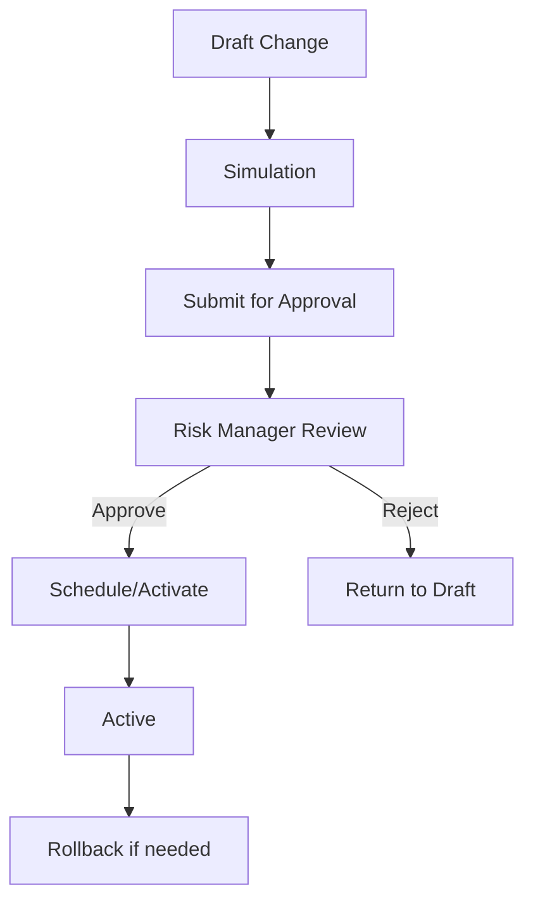

# 14 — Audit & Governance

## 1. Governance Goals

- Prevent uncontrolled policy changes.
- Make every decision reconstructable.
- Ensure policy changes are reviewed and approved.
- Support compliance/internal audit.
- Allow rollback when policy causes negative impact.

## 2. What Must Be Audited

| Area | Events |
|---|---|
| Decision Runtime | Decision executed, error, timeout, fallback |
| Rule Management | Rule created, edited, submitted, approved, activated, retired |
| Strategy | Strategy version created, steps changed, activated, rolled back |
| Reason Code | Created/edited/deactivated |
| Simulation | Simulation executed, result exported |
| Manual Review | Case assigned, analyst decision, override, escalation |
| Access | Login, sensitive data viewed, export |
| Admin | Role/permission changes |

## 3. Audit Log Format

```json
{
  "event_type": "RULE_VERSION_ACTIVATED",
  "actor": {
    "type": "USER",
    "user_id": "USR-001",
    "role": "RISK_MANAGER"
  },
  "entity": {
    "type": "RULE_VERSION",
    "id": "rv_123",
    "code": "DTI_MAX_STANDARD"
  },
  "before": {
    "status": "PENDING_APPROVAL"
  },
  "after": {
    "status": "ACTIVE"
  },
  "metadata": {
    "correlation_id": "corr-001",
    "approval_request_id": "apr_001"
  },
  "created_at": "2026-07-04T10:30:00+07:00"
}
```

## 4. Versioning Rules

- Active rule/strategy/model config is immutable.
- Editing active config creates new draft version.
- Every production decision references exact strategy/rule/model version.
- Retired version remains readable for audit.
- Rollback means activating a previous version, not deleting current version.

## 5. Maker-Checker Workflow

MVP can implement basic permission-controlled activation. Phase 2 should implement full maker-checker.



## 6. Approval Requirements

Before activating policy/rule/strategy:

- change diff available,
- simulation result attached,
- reason for change filled,
- approver is different from maker,
- audit log recorded.

## 7. Permissions

| Permission | Role Examples |
|---|---|
| `decision.view` | Risk, Underwriter, Compliance |
| `decision.trace.view` | Risk, Underwriter, Compliance, Auditor |
| `rule.create` | Risk Policy Analyst |
| `rule.approve` | Risk Manager |
| `strategy.activate` | Risk Manager/Admin |
| `manual_review.decide` | Underwriter |
| `manual_review.override` | Senior Underwriter/Supervisor |
| `audit.view` | Compliance, Auditor |
| `pii.view` | Restricted roles |
| `data.export` | Restricted roles |

## 8. Rollback

Rollback requirements:

- select previous active strategy version,
- require permission,
- record reason,
- record audit log,
- preserve failed/current version,
- monitor post-rollback metrics.

## 9. Compliance Considerations

- Store decision trace long enough for audit/legal requirements.
- Mask PII by default.
- Restrict export.
- Log access to sensitive records.
- Ensure reason codes are standardized and not arbitrary free text.
- Maintain policy change evidence.

## 10. Technical Logs vs Decision Trace vs Business Audit

| Evidence | Purpose | Typical Data | Access |
|---|---|---|---|
| Technical log | Runtime diagnosis | event, duration, safe error, request/correlation ID | Engineering/Ops |
| Decision trace | Explain/reproduce decision | immutable input/features/versions/steps/output | Risk/Underwriting/Audit |
| Business audit | Governance proof | actor, action, entity/version, reason, before/after | Compliance/Internal Audit |

The layers must remain separate and be linked through correlation/entity identifiers.

## 11. Audit Integrity

- Audit events are append-only from the application perspective.
- Ordinary users cannot edit or delete audit history.
- Corrections create new events.
- Critical state changes fail explicitly when mandatory audit persistence fails.
- Store safe before/after diffs; do not duplicate prohibited PII.
- Audit access and exports are themselves audited.

## 12. Correlation, Retention, and Redaction

- Propagate request/correlation IDs to trace and audit records.
- Retention periods are configurable and require company/legal approval.
- PII is masked by default.
- Raw credentials, tokens, documents, and third-party payloads are never stored in audit metadata.
- Purge/archival mechanisms must preserve approved legal/audit requirements.
